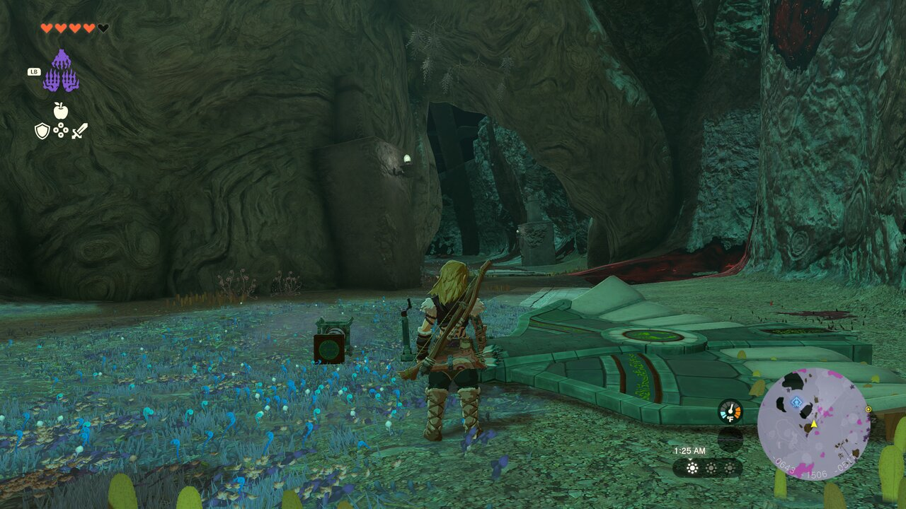

# TotK Recomp Live Spawner

**A completely vibecoded, highly experimental Tears of the Kingdom Recomp mod that spawns arbitrary in-game actors live, without save editing or reloading.**

Press **J** to spawn a four-part Zonai build, or use the Python CLI to spawn a particular actor by its internal ID. This is a Linux x86-64 / X11 prototype built against a specific **TotK Recomp / TotK 1.4.3** executable, not a plug-and-play mod for every build. Incompatible executables are rejected by a SHA-256 guard.



## What it does

- Live actor creation through TotK's own `f_7000599670` factory, invoked on the game actor thread at a recurrent SVC checkpoint.
- Local Unix-domain socket API and `spawn.py` CLI, without an HTTP server or external service.
- **J hotkey** while TotK Recomp is focused (X11 only): spawn four independently placed parts near Link, with scales configurable in `spawn.py`.
- Uses Link's **actual facing direction**, not the world Z axis or the camera angle, for the four-part layout.
- Adds a verified `0x05` creation flag and unique retained backing memory for each request. Without this flag, the factory returned `1` but no model appeared during testing.

### J batch contents

| Order | Actor | Scale | Forward from Link | Sideways from center | Up |
|---|---|---:|---:|---:|---:|
| 1 | `SpObj_LiftGeneratorWing_A_01_MiniGame` | 1.0 | 3 | −3 | 1 |
| 2 | `AsbObj_WagonSteeringCollectObject_A_01` | 0.15 | 5 | −1 | 1 |
| 3 | `SpObj_ControlStick_A_01` | 1.0 | 7 | +1 | 1 |
| 4 | `SpObj_SpringPiston_A_01` | 0.4 | 9 | +3 | 1 |

Each subsequent part moves **2 units farther ahead and 2 units sideways** relative to the preceding part (about 2.83 units apart diagonally), reducing collisions compared with stacking them at one position. Because these are real physics objects, collisions and breakage are still possible. These are **four independently spawned parts**; they are not glued together automatically.

You can edit `FOUR_ACTORS`, `FOUR_FORWARD`, `FOUR_UP`, and `FOUR_SEPARATION` near the top of `spawn.py`. The `J` handler reads the script on each keypress, so editing those values does not require restarting the game.

## Requirements

- Linux x86-64 and an X11 session (the J key listener uses X11). Fedora Xfce was used for development and testing.
- An existing TotK Recomp 1.4.3 installation with the **exact native executable build** this prototype was developed against. The native hooks use fixed x86-64 addresses and prologue checks; the DLL deliberately refuses another binary's hash instead of risking memory corruption.
- Python 3.10+, C compiler (`cc`), OpenSSL development headers/library, X11 library, and `xdotool` for focused-window detection.
- TotK Recomp's standard game files. No Nintendo game files are included here.

Fedora build dependencies can be installed with `sudo dnf install gcc openssl-devel python3 libX11 xdotool`.

**Compatibility limitation:** Until the hardcoded native addresses are converted into reliable per-build symbol resolution, public clones of the repository will generally **not** work against arbitrary other Recomp releases or personally rebuilt executables. A matching TotK 1.4.3 *game version* alone does not guarantee a matching native binary. Contributions to portable symbol resolution are welcome.

## Build and launch

```bash
# After cloning into any directory:
./build.sh

# Your existing game launcher is expected at ~/Applications/TotK-Recomp/launch.sh
./launch.sh

# If installed elsewhere:
TOTK_RECOMP_ROOT=/path/to/TotK-Recomp ./launch.sh
```

`launch.sh` wraps the existing TotK Recomp launcher, preserving its controller configuration. The spawner and focus-aware `J` watcher exit when the game closes. Ordinary TotK starts remain unchanged.

## Spawn commands

Run in a second terminal after loading a save:

```bash
# Confirm that the native actor-thread dispatcher is active.
python3 spawn.py --status

# Spawn a spring two units right, three up and two along world Z.
python3 spawn.py SpObj_SpringPiston_A_01 --scale 1 --offset 2 3 2

# Spawn something five units *above* Link.
python3 spawn.py AsbObj_MetalRectangle_A_M_01 --scale 1.5 --offset 0 5 0

# Same four-part batch as the J hotkey.
python3 spawn.py --four

# Cancel a queued (not-yet-executed) request.
python3 spawn.py --cancel
```

Single-actor `--offset X Y Z` values are relative to Link's current **position in world axes**. The J batch instead converts the relative **forward/right/up** layout into world axes using the player's live transform. Scaling accepts 0.05–5.0 by default. Not every internal actor ID or initialization state is guaranteed to work.

`spawn.py` uses the current user's Unix socket (`0600`, peer UID checked); it does not make requests over the internet.

## Tests

```bash
python3 -m unittest discover -s tests -v
```

In-game verification used an **isolated test save profile**, not the player's real saves. We confirmed a metal rectangle physically falling onto Link, then a focused `J` keypress dispatching all four named actors with different positions. The minigame wing and other Zonai devices appeared in before/after screenshots. Neither the base TotK executable nor the user's original launcher was modified.

## Technical notes / risks

The project was built by reverse-engineering behavior in the installed TotK 1.4.3 and UltraCam binaries and in Recomp's generated C. It **does not bundle** an UltraCam binary or game files. It is deliberately experimental: it injects hooks with `LD_PRELOAD` into a known native function, and calling undocumented game internals can crash the game. Test on a disposable copy of your save profile; backups are recommended. Actor creation is asynchronous, so the code retains its per-request backing buffers for the life of the game process. The `--status` registry counter is an internal queue/bucket statistic, **not** a reliable count of visible world actors. Factory return `1` alone does not prove a visible object was instantiated.

The native function offsets, platform assumptions, initialization flags, and object lifetimes all warrant further investigation. Spawning items does not automatically make them buildable, fused, glued, saved, or permanent, and it does not reproduce an entire Autobuild blueprint.

This is an unofficial community experiment, not affiliated with Nintendo or the TotK Recomp team. The MIT license covers this repository's original source code, not Nintendo game assets depicted in screenshots.
